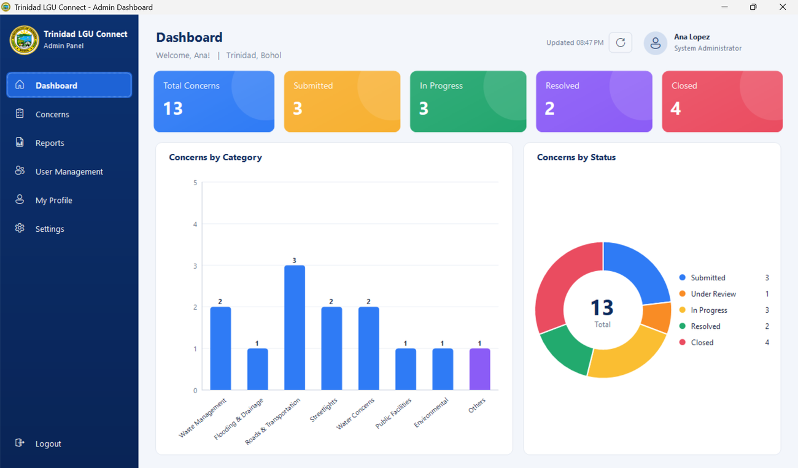

# Trinidad LGU Connect

**Community Concern Reporting and Monitoring System** for the Municipality of Trinidad, Bohol.
A VB.NET Windows Forms desktop application backed by MySQL.

Residents register, report community concerns (with photos) and track their status.
LGU administrators and staff review concerns, update their status with remarks, manage users,
and generate, export and print reports.



---

## Contents

1. [Features](#features)
2. [Technology and compatibility decisions](#technology-and-compatibility-decisions)
3. [Prerequisites](#prerequisites)
4. [First-time setup](#first-time-setup)
5. [Configuring email (SMTP)](#configuring-email-smtp)
6. [Configuration reference](#configuration-reference)
7. [Build and run](#build-and-run)
8. [Tests](#tests)
9. [Publishing for Windows](#publishing-for-windows)
10. [Project structure and architecture](#project-structure-and-architecture)
11. [Security model](#security-model)
12. [Remaining production requirements](#remaining-production-requirements)
13. [Dependencies and licences](#dependencies-and-licences)
14. [Troubleshooting](#troubleshooting)

Screen-by-screen checklist, interactive-element audit and test results: [docs/CHECKLIST.md](docs/CHECKLIST.md).

---

## Features

**Resident**
- Registration with email verification (8-character single-use code)
- Login with username **or** email, show/hide password, forgot-password recovery
- Dashboard: Total / In Progress / Resolved / Closed cards (click to filter), recent reports, live clock, notification bell
- Report a Concern: category, optional subcategory, **barangay (type or pick from the 20 barangays of Trinidad)**, street/purok/landmark, description, date reported, up to 5 photos
- Select and Attach Picture dialog: Windows file picker or drag-and-drop, previews, remove before attaching
- My Reports: search, category/status/location/date filters, paging, view details, open photos
- Concern Details: information, all photos (click to open the viewer), status timeline built from saved history, full history list
- Withdraw a report that is still *Submitted*, or confirm and close a *Resolved* report
- My Profile (residents **and** LGU personnel): profile picture (upload / remove), full name, contact number, barangay, address; settings (email notification preference, change password)

**Administrator / Staff**
- Dashboard: Total / Submitted / In Progress / Resolved / Closed cards, *Concerns by Category* bar chart, *Concerns by Status* donut (all clickable)
- Submitted Concerns: search, category/status/**barangay**/date filters, paging, view, open photos, update status
- Concern Details with photos and status history; Update Concern Status (only workflow-valid targets, remarks, update date, history table)
- Reports and Analytics: report type, date range presets or custom range, pie/bar charts, summary, Status / Category / Date Range reports
- Report Preview with **Print**, **Print Preview**, **Export PDF**, **Export Excel (.xlsx)** and **Export CSV**
- User Management: search/filter, add, edit, activate/deactivate, delete (only unused accounts), role assignment
- Settings: system/security/notification settings stored in MySQL, SMTP configuration with test email, database status, audit log

**Image viewer** (everywhere a photo appears): previous/next, zoom in/out (buttons, keys, mouse wheel), fit to window, actual size, pan, file name and size, close.

---

## Technology and compatibility decisions

| Area | Choice | Why |
|---|---|---|
| Runtime | **.NET 10** (`net10.0-windows`), VB.NET, Windows Forms | Matches the Visual Studio 2026 project you created; current LTS line. |
| Database | **MySQL 8.0.16+** (tested on **MySQL 9.7.0**) via **MySQL Connector/NET** (`MySql.Data`) | As requested. The schema uses expression defaults (`DEFAULT (UTC_TIMESTAMP())`), which need 8.0.13+. |
| Passwords | **PBKDF2-HMAC-SHA256, 600,000 iterations, 128-bit salt** (built into .NET) | OWASP-recommended parameters; no native dependency to deploy. Hashes are upgraded automatically if the iteration count is raised later. |
| Email | **MailKit** | The modern, maintained SMTP client for .NET (`System.Net.Mail.SmtpClient` is not recommended for new code). |
| Charts | **Owner-drawn GDI+ controls** (`BarChart`, `DonutChart`) | Pixel-level match with the reference design and no charting runtime to ship. The classic `System.Windows.Forms.DataVisualization` chart is not part of modern .NET. |
| PDF | **PDFsharp 6.2.4 (MIT)** | Pinned deliberately: PDFsharp **6.5+ is AGPL-3.0** and enforces a licence check at run time. |
| Excel | **ClosedXML (MIT)** | Real `.xlsx` files without Office installed. |
| Printing | `System.Drawing.Printing` | One report renderer draws the on-screen preview, the printer pages and the PDF, so all three show identical data. |
| High DPI | `DpiUnawareGdiScaled` | The UI is built in code at 96-DPI coordinates with many owner-drawn controls. Windows scales it uniformly at 125-200% while GDI text stays sharp. (Verified on a 150% display.) |
| Solution file | `TrinidadLGUConnect.slnx` | The XML solution format created by Visual Studio 2026; it also opens in Visual Studio 2022 17.13+ and works with the `dotnet` CLI. |

---

## Prerequisites

- Windows 10 or 11
- [.NET 10 SDK](https://dotnet.microsoft.com/download) (to build) or the .NET 10 Desktop Runtime (to run a framework-dependent build). A self-contained publish needs neither.
- Visual Studio 2026 (or 2022 17.13+) with the *.NET desktop development* workload — optional, the CLI is enough
- MySQL Server 8.0.16 or newer
- An SMTP account for email features (Gmail with an App Password, Microsoft 365, or the LGU mail server)

---

## First-time setup

1. **Start the application** (`F5` in Visual Studio, or `dotnet run --project TrinidadLGUConnect`).
2. The splash screen checks the database. Because nothing is configured yet, the **Database Setup** wizard opens:
   - Enter server, port, database name (default `trinidad_lgu_connect`), MySQL user and password.
   - **Test Connection** reports what it found.
   - **Create / Update Schema** creates the database if it is missing and any missing tables and reference data.
     It is non-destructive: it never drops, truncates or deletes anything. This step needs an account with `CREATE` privileges.
   - **Save & Continue** stores the settings in `%ProgramData%\TrinidadLGUConnect\appsettings.local.json` with the password encrypted by Windows DPAPI.
3. Because no administrator exists yet, the **Initial Administrator Setup** form opens. Create the first administrator
   (password: at least 12 characters with upper/lower case, a number and a symbol). This screen can only ever be completed once;
   it is re-checked inside a locked database transaction, so it cannot be repeated later to gain administrator access.
   There is **no default administrator password** anywhere in the source.
4. Log in through **Admin / LGU Personnel Login**, open **Settings → Email (SMTP)** and configure email (next section).
5. Recommended for production: create a least-privilege MySQL account with [`database/create_app_user.sql`](database/create_app_user.sql)
   and switch the connection to it (the app needs only `SELECT, INSERT, UPDATE, DELETE`).

Alternatively, run the schema by hand: `mysql -u <admin> -p trinidad_lgu_connect < database/schema.sql` (create the database first).

---

## Configuring email (SMTP)

Email is used for verification codes, password-reset codes, password-changed notices, report receipts and status-change notifications.
Without SMTP the rest of the application works, but:
- residents cannot self-verify (an administrator can tick *Email address verified* in User Management, or turn off
  *Require email verification* in Settings), and
- password recovery is reported as unavailable instead of pretending an email was sent.

Configure it in **Settings → Email (SMTP) → Configure SMTP** (administrators only), then use **Send Test Email**.

| Field | Gmail | Microsoft 365 |
|---|---|---|
| SMTP Server | `smtp.gmail.com` | `smtp.office365.com` |
| Port | `587` | `587` |
| Security | `StartTls` (or `SslOnConnect` with port 465) | `StartTls` |
| User Name | your Gmail address | your mailbox address |
| Password | a 16-character **App Password** (requires 2-Step Verification) — not your normal password | the mailbox password or an app password, per your tenant policy |
| Sender Email | the same address | the same address (or one the mailbox may send as) |

SMTP settings are stored **per workstation** in `%ProgramData%\TrinidadLGUConnect\appsettings.local.json`; the password is
DPAPI-encrypted and is never displayed again. Configure each workstation that will send email, or set the environment
variables below (e.g. through Group Policy).

---

## Configuration reference

Configuration is merged in this order (later wins):

1. `appsettings.json` next to the executable — committed defaults, **no secrets**
2. `appsettings.local.json` next to the executable — developer machine, git-ignored (see `appsettings.local.example.json`)
3. `%ProgramData%\TrinidadLGUConnect\appsettings.local.json` — written by the setup wizard and the SMTP dialog (DPAPI-encrypted passwords)
4. Environment variables:

| Variable | Meaning |
|---|---|
| `TLC_DB_CONNECTION` | Full MySQL connection string (overrides the `Database` section) |
| `TLC_SMTP_HOST`, `TLC_SMTP_PORT`, `TLC_SMTP_SECURITY` | SMTP server, port, `None`/`StartTls`/`SslOnConnect`/`Auto` |
| `TLC_SMTP_USER`, `TLC_SMTP_PASSWORD` | SMTP credentials |
| `TLC_SMTP_FROM` | Sender address |

System-wide settings (municipality label, rows per page, email-verification requirement, session timeout, lockout threshold and
duration, code lifetime, picture size/count limits, notification switches) are stored in the `app_settings` table and edited in
**Settings**; they apply to every workstation.

Images: the seal, background and panel photos are in `Resources\Images` next to the executable and can be replaced with
higher-resolution originals (same file names) without recompiling. The background photos were extracted from the 826 × 550 px
reference mock-ups, so a higher-resolution photo of Trinidad will look sharper.

---

## Build and run

```powershell
cd TrinidadLGUConnect          # the folder containing TrinidadLGUConnect.slnx
dotnet build TrinidadLGUConnect.slnx
dotnet run --project TrinidadLGUConnect
```

Or open `TrinidadLGUConnect.slnx` in Visual Studio and press **F5**. All forms are built in code (there are no `.Designer.vb`
files), so nothing has to be dragged onto a designer surface.

Logs (technical details only — never passwords, codes or tokens): `%LocalAppData%\TrinidadLGUConnect\logs\app-YYYYMMDD.log`.

---

## Tests

```powershell
dotnet test TrinidadLGUConnect.slnx
```

- **Unit tests** always run: password hashing, validation, one-time codes, workflow rules, schema script safety, date ranges,
  CSV/Excel/PDF export, report pagination, image validation/re-encoding.
- **Database integration tests** run when `TLC_TEST_DB` is set to a MySQL connection string (no database name) for an account
  that may create and drop databases. Each run creates a uniquely named `tlc_test_*` database and drops **only that database**
  afterwards (set `TLC_KEEP_TEST_DB=1` to keep it). An in-process fake SMTP server captures email, so registration
  verification, password recovery and notifications are exercised through the real MailKit code.

  ```powershell
  $env:TLC_TEST_DB = "Server=localhost;Port=3306;User ID=root;Password=<your password>"
  dotnet test TrinidadLGUConnect.slnx
  ```
- **UI screenshot test** (`Category=UI`, needs `TLC_TEST_DB` and an interactive desktop): seeds realistic data, opens every
  screen and dialog, fails if any screen raises an error, and saves screenshots to `TLC_SCREENSHOT_DIR`
  (default: the test output `screenshots` folder). The images in `docs/screenshots` come from this test.

---

## Publishing for Windows

Self-contained (no .NET runtime needed on the target PCs, ~140 MB):

```powershell
dotnet publish TrinidadLGUConnect\TrinidadLGUConnect.vbproj -c Release -r win-x64 --self-contained true -o publish\win-x64
```

Framework-dependent (smaller; requires the .NET 10 Desktop Runtime on each PC):

```powershell
dotnet publish TrinidadLGUConnect\TrinidadLGUConnect.vbproj -c Release -r win-x64 --self-contained false -o publish\win-x64-fd
```

Copy the `publish\...` folder to each workstation (or a network share) and create a shortcut to `TrinidadLGUConnect.exe`.
On first start each workstation shows the Database Setup wizard; point it at the shared MySQL server. Photos are stored in the
database, so every workstation sees the same pictures. For signed installers, wrap the publish folder with your preferred
tool (MSIX, Inno Setup, WiX) and sign the executable with the LGU's code-signing certificate.

---

## Project structure and architecture

```
TrinidadLGUConnect/
├── TrinidadLGUConnect.slnx
├── TrinidadLGUConnect/                 # the WinForms application
│   ├── Program.vb                      # entry point, DPI mode, global error handling
│   ├── Configuration/AppConfig.vb      # layered configuration + DPAPI secrets
│   ├── Data/                           # connection factory, transactions, schema initializer
│   ├── Models/                         # entities, enums, permission codes, report models
│   ├── Repositories/                   # all SQL (parameterised) - users, concerns, sessions, tokens, settings, audit
│   ├── Services/                       # Auth, Authorization, Concern (workflow), Attachment, Email,
│   │                                   # Reporting, ReportRenderer, Export, Settings, User, Setup, AppLog
│   ├── Helpers/                        # validation, secure random codes, formatting
│   ├── Controls/                       # theme tokens and owner-drawn controls (sidebar, cards, grid, charts, viewer parts)
│   ├── Forms/Authentication/           # landing, logins, registration, recovery, verification, setup wizards
│   ├── Forms/Resident/                 # dashboard, report a concern, details, profile, settings
│   ├── Forms/Admin/                    # dashboard, concerns, update status, reports, preview, users, settings
│   ├── Forms/Shared/                   # app controller, main shell, image viewer, attach dialog, helpers
│   └── Resources/                      # seal, background photos, icon
├── database/schema.sql                 # idempotent, non-destructive schema + reference data (embedded in the app)
├── database/create_app_user.sql        # least-privilege MySQL account
├── tests/TrinidadLGUConnect.Tests/     # xUnit unit, integration and UI screenshot tests
└── docs/                               # checklist, screenshots
```

- **Forms never contain SQL.** Pages call services; services enforce validation, authorization and workflow rules and open
  transactions; repositories hold the parameterised SQL.
- **Background work:** MySQL Connector/NET's async methods complete synchronously, and password hashing is CPU-bound, so every
  service call from the UI runs on a background thread (`TryRunAsync`) with a busy indicator and disabled buttons.
- **Navigation:** `AppController` keeps exactly one top-level window (splash, a login screen, registration or the main shell).
  The main shell hosts pages with a back stack, so *Close/Cancel/Back* returns to the previous screen, which reloads its data.
  After any submission or status change, the visible page refreshes; the admin dashboard also refreshes every 60 seconds,
  and every list has a Refresh button for changes made on other workstations.
- **Schema versioning:** `schema_migrations` records the applied version (current: **2**, which added barangays and profile photos);
  `DatabaseInitializer.CurrentSchemaVersion` is checked at startup. An older database shows the setup screen, where
  **Create / Update Schema** adds only the missing tables/columns and keeps all data.

---

## Security model

- Passwords: PBKDF2-SHA256 (600k iterations, per-user salt), constant-time comparison; never stored, logged or emailed in plain text.
- Login: same generic message for unknown user and wrong password (with equalised timing); account lockout after N failures
  (default 5 → 15 minutes); throttling per identifier and per workstation; deactivated accounts cannot sign in; residents must
  verify email (configurable).
- Sessions: a random 256-bit token per login; only its SHA-256 hash is stored in `user_sessions`. **Every privileged call
  re-validates the session against MySQL and re-reads the user's role, active flag and permissions**, so editing values in
  client memory cannot elevate privileges (covered by a test). Sliding idle expiry (default 30 min), logout and window close
  revoke the session; password changes, password resets, deactivation and role changes revoke other sessions.
- Authorization: role → permission mapping in `role_permissions`; residents are restricted to their own reports **in the SQL
  query**; "not found" and "not yours" return the same message so report IDs cannot be probed. Staff cannot manage users or
  settings; only administrators can create administrators; nobody can change their own role or deactivate themselves; the last
  active administrator cannot be removed.
- Recovery and verification codes: 8 characters from a 31-symbol alphabet (~40 bits), single use, expire (default 15 min),
  max 5 wrong attempts per code, max 3 requests per address per hour and 1 per minute, only SHA-256 hashes stored, previous codes
  revoked on each request, undelivered codes revoked when SMTP fails. Unknown addresses get the same response as known ones.
- Workflow: status transitions come from `concern_status_transitions`; updates lock the row (`SELECT … FOR UPDATE`), check the
  expected current status (stale screens are rejected) and append a history row — history is never overwritten.
- Uploads: only `.jpg/.jpeg/.png`, size limit, magic-byte check, full decode, pixel-count limit, re-encoding (strips EXIF/GPS
  metadata and crafted payloads), file names sanitised; images are stored in MySQL, never at user-supplied paths.
- SQL: parameters for every value; identifiers come only from fixed lists; `LIKE` wildcards in search text are escaped.
- Exports: CSV cells beginning with `= + - @` are neutralised; Excel text is written as text; files are written atomically.
- Audit log: logins and failures, lockouts, registrations, verifications, password changes and resets, submissions, status
  changes, user creation/updates/role changes/activation/deletion, settings and SMTP changes, report generation/export/print.
- Errors: users see safe messages; technical details go to the local log only.

## Remaining production requirements

These are outside what a desktop client can guarantee on its own and should be addressed before a public deployment:

1. **Two-tier trust boundary.** Every workstation connects directly to MySQL, so the MySQL credentials on a workstation are
   ultimately readable by someone with administrator rights on that PC (DPAPI machine scope). The server-side session checks stop
   in-app privilege escalation, but a determined local administrator could use the database account directly. For
   internet-facing or untrusted-PC use, put a small HTTPS API between the app and MySQL and keep database credentials on the server.
2. Use the least-privilege `tlc_app` account, restrict MySQL to the LGU network/VPN, and require TLS (`SslMode=Required` with a
   proper server certificate).
3. Back up the `trinidad_lgu_connect` database (it contains the photos) on a schedule, and test restores.
4. Sign the executable and installer with an organisational code-signing certificate.
5. Configure SMTP with SPF/DKIM-aligned sender addresses so codes are not marked as spam.
6. Decide a retention policy for `auth_attempts`, `user_sessions` and `audit_logs` (they grow over time).
7. Replace the background photographs with high-resolution originals (see *Configuration reference*).
8. Review the Data Privacy Act of 2012 (RA 10173) obligations for resident data and photos (privacy notice, retention, access).

---

## Dependencies and licences

| Package | Version | Licence | Notes |
|---|---|---|---|
| MySql.Data (MySQL Connector/NET) | 26.7.0 | GPL-2.0 with Universal FOSS Exception | Requested driver. If the GPL terms are unsuitable for your distribution, `MySqlConnector` (MIT) is an API-compatible alternative. |
| MailKit | 4.18.1 | MIT | SMTP |
| PDFsharp | 6.2.4 | MIT | Pinned below 6.5 (AGPL). |
| ClosedXML | 0.105.1 | MIT | Excel export |
| xUnit, Microsoft.NET.Test.Sdk | 2.9.3 / 18.0.1 | Apache-2.0 / MIT | Tests only |

Icons come from the Windows *Segoe Fluent Icons* / *Segoe MDL2 Assets* fonts installed with Windows; no icon files are shipped.

---

## Troubleshooting

| Symptom | Fix |
|---|---|
| Database Setup appears on every start | The saved settings cannot connect. Check that MySQL is running and the user/password are correct; use **Test Connection**. If the PC was re-imaged, DPAPI cannot decrypt the old password — re-enter it. |
| "The database schema is incomplete" | Run **Create / Update Schema** with an account that has `CREATE` privileges, then switch back to `tlc_app`. |
| "Password recovery by email is not available" | SMTP is not configured on this workstation (Settings → Email). |
| Emails are not received | Use **Send Test Email**; check the spam folder; for Gmail use an App Password. The app only reports success when the SMTP server accepted the message. |
| Account locked | Wait for the lockout period (Settings → Security) or reset the password. |
| Locked out of every administrator account | A database administrator can clear a lockout with `UPDATE users SET failed_login_count = 0, lockout_until = NULL WHERE username = '…'`, or promote a trusted staff account with `UPDATE users SET role_id = 1 WHERE username = '…'` and then reset passwords in User Management. Requires DBA access by design. |
| "No printer is installed" | Install a printer or *Microsoft Print to PDF*, or use **Export PDF**. |
